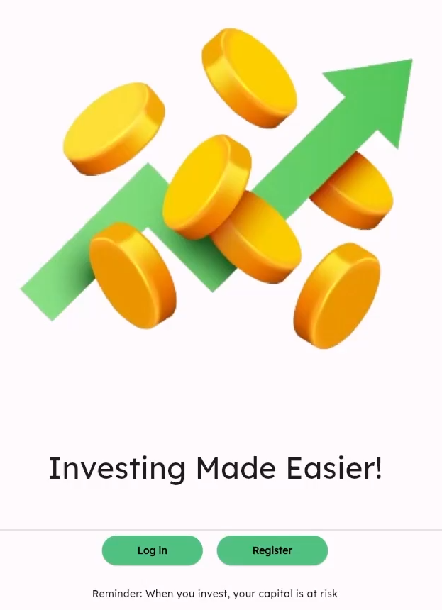
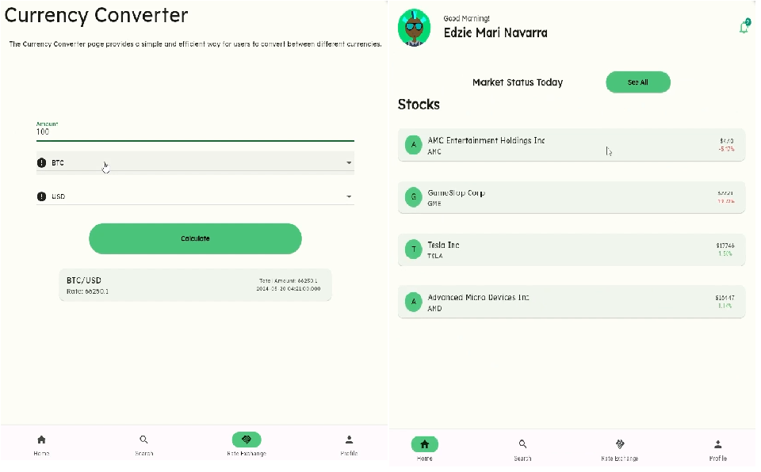
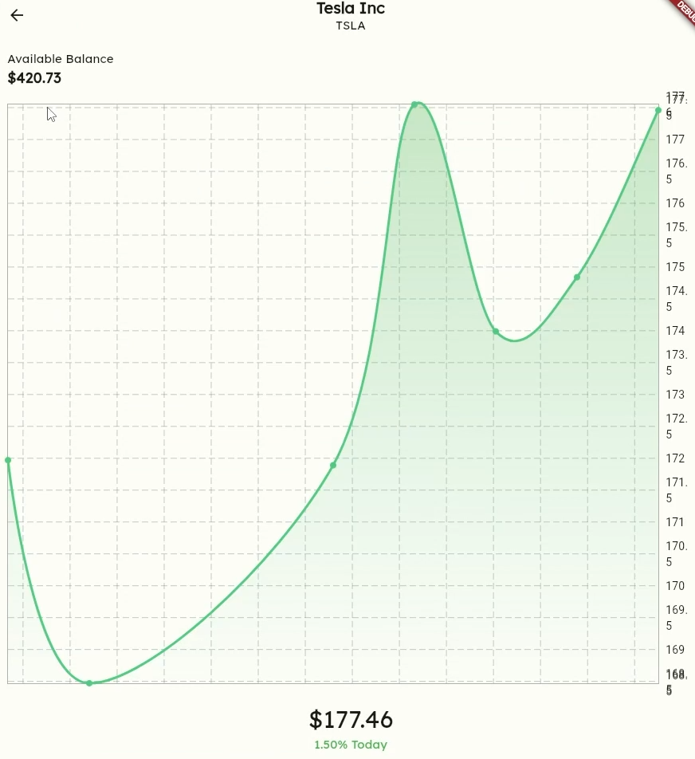

# Forex_app

An application that lets users track their total currency from a wide choices of cryptocurrency.

[](flutter.dev)
[](https://palletsprojects.com)
[](https://twelvedata.com)



# Features

- **Real-time Market & Crypto Tracking:** Provides instantaneous live asset streaming and price updates powered by the TwelveData API.
- **Interactive Trend Analysis:** Dynamic graphing interface that charts historical price paths and current trends for targeted market instruments.
- **Global Search Engine:** Responsive lookup system enabling users to find explicit currency pairs, equities, and high-cap crypto assets instantly.
- **Multi-Asset Exchange Calculator:** High-precision converter that processes cross-rate equations between standard fiat pairs and volatile digital assets.
- **Secure Session Infrastructure:** User onboarding, credential authentication, and persistent sign-in flows integrated through Firebase Auth.

# Tech Stack

```
    Flutter
    Flask
    Firebase
    TwelveData API
```

## 📸 Interface Preview

| Dashboard & Conversion          | Trend Graph & Analysis      |
| ------------------------------- | --------------------------- |
|  |  |

# Setting up Flask

**Navigate to Flask Folder**

    `cd flask`

**Setup venv (Windows)**

    `.venv\Scripts\activate`

**Setup venv (Linux)**

    `source ~/.venv/bin/activate`\

**Install requirements**

    `pip install -r requirements.txt`

**Run Flask Server**

    `flask run --debug`
